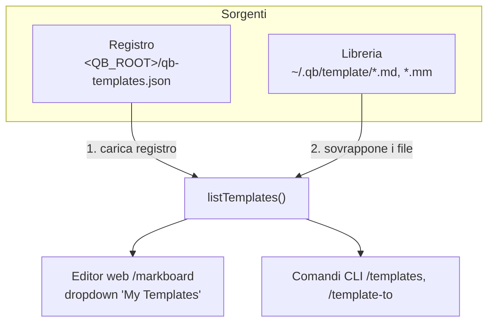

# Guida ai Template

Questa guida spiega come usare i **template** di documenti in KubiRAG, sia dall'editor web
(`/markboard`) sia dai comandi CLI, e soprattutto **dove vengono scritti e letti i file**.

Un template è semplicemente un documento Markdown riutilizzabile (es. README, SWOT, Business Model
Canvas) che puoi caricare nell'editor come punto di partenza, oppure clonare in un nuovo documento.

---

## Dove vengono scritti/letti i file

KubiRAG gestisce i template in **due posizioni distinte** che vengono combinate a runtime:

| Cosa | Percorso | Contenuto | Chi lo usa |
|---|---|---|---|
| **Libreria** | `~/.qb/template/*.md` e `*.mm` | I file template veri e propri (il contenuto Markdown) | Scansionata automaticamente ad ogni `listTemplates()` |
| **Registro** | `<QB_ROOT>/qb-templates.json` | Una mappa `nome → percorso` dei template registrati | Caricato all'avvio della lista |

Dettagli importanti:

- **Libreria** (`~/.qb/template/`): si basa su `System.getProperty("user.home")`, quindi è sempre
  nella **home dell'utente** ed è **condivisa fra tutti gli store**. **Non** è influenzata da
  `QB_ROOT_PATH`. Vengono riconosciuti solo i file con estensione `.md` o `.mm`.

- **Registro** (`qb-templates.json`): viene scritto in `KubiConfig.qbRootPath()`, cioè la cartella
  `.qb/` del progetto corrente (oppure il percorso indicato dalla variabile d'ambiente
  `QB_ROOT_PATH`, se impostata). Contiene **solo riferimenti** (nome + percorso file), non il
  contenuto.

- **Fusione**: `listTemplates()` prima carica il registro JSON, poi **sovrappone** i file trovati
  nella libreria `~/.qb/template/`. Un template può quindi provenire da una delle due fonti, indicizzato
  per nome. Se libreria e registro hanno la stessa chiave, vince la libreria.

> ⚠️ Conseguenza pratica: se elimini a mano un file da `~/.qb/template/` ma il suo riferimento è
> rimasto nel `qb-templates.json`, la lista può ancora mostrarne il nome. Caricarne il contenuto
> restituirà però "Template not found" perché il file non esiste più.



---

## Uso dall'editor web (`/markboard`)

Avvia il server (`make server`) e apri <http://localhost:7070/markboard>.

### Caricare un template

1. Apri il menu a tendina dei template in alto.
2. Oltre ai template **predefiniti** (README, SWOT, Business Model Canvas, Mindmap, ecc., integrati
   nella pagina), trovi il gruppo **"My Templates"** popolato dalla tua libreria server
   (`~/.qb/template/`).
3. Seleziona un template: il contenuto viene caricato nell'editor e mostrato in anteprima.

> I template predefiniti sono dentro la pagina HTML. Quelli del gruppo "My Templates" vengono letti
> dal server **al momento della selezione** (una sola chiamata di rete, non al caricamento pagina).

### Salvare il documento corrente come template

1. Scrivi/incolla il Markdown nell'editor.
2. Premi il pulsante **⭐ Save as Template**.
3. Inserisci un nome quando richiesto.
4. Il contenuto viene salvato in `~/.qb/template/<nome>.md` e registrato in `qb-templates.json`. Il
   menu a tendina si aggiorna immediatamente con la nuova voce.

Il nome viene normalizzato: gli spazi iniziali/finali vengono rimossi, i caratteri `/` e `\` sono
sostituiti con `_`, e l'estensione `.md` viene aggiunta automaticamente (se già presente non viene
duplicata).

### Endpoint REST utilizzati

L'editor dialoga con il controller `CtrlTemplates`:

| Metodo | Endpoint | Descrizione |
|---|---|---|
| `GET` | `/templates` | Elenco dei nomi: `[{ "name": "..." }]` (solo metadati) |
| `GET` | `/templates/{name}` | Contenuto: `{ "name": "...", "content": "..." }` |
| `POST` | `/templates` | Crea: body `{ "name", "content" }` → `201 { "name" }` |

Esempi con `curl`:

```bash
# Elenco
curl localhost:7070/templates

# Crea un template dal contenuto
curl -X POST localhost:7070/templates \
  -H 'Content-Type: application/json' \
  -d '{"name":"todo","content":"# TODO\n- [ ] primo task\n"}'

# Leggi il contenuto (il nome include l'estensione .md)
curl localhost:7070/templates/todo.md
```

---

## Uso da CLI

Avvia la CLI con `make cli`. Sono disponibili i seguenti comandi.

### /templates — Elenca i template

Mostra tutti i template (libreria + registro), con nome e percorso file.

```
/templates
```

**Output di esempio:**
```
todo.md                       /home/utente/.qb/template/todo.md
swot.md                       /home/utente/.qb/template/swot.md
readme-v1.md                  /progetto/doc/readme-v1.md
```

### /template — Dettagli di un template

Mostra nome e percorso di un singolo template. Supporta TAB completion sui nomi.

```
/template <templateName>
```

**Esempio:**
```bash
/template todo.md
# template todo.md : [/home/utente/.qb/template/todo.md]
```

### /template-add — Registra un template esistente

Aggiunge al **registro** (`qb-templates.json`) un riferimento a un file già esistente sul disco. Non
copia né sposta il file: ne memorizza solo nome e percorso.

```
/template-add <templateName> <templatePath>
```

**Esempi:**
```bash
/template-add todo-v1.md /doc/
/template-add todo-v1.md ./templatedir/todo-v1.md
/template-add todo-v1.md /doc/todo-v1.md
```

### /template-import — Importa una cartella di template

Registra in blocco tutti i file `.md` presenti nella cartella indicata.

```
/template-import <pathTemplateToImport>
```

**Esempio:**
```bash
/template-import ./doc/templates/
# Ok. imported templates from [./doc/templates/].
```

### /template-to — Crea un nuovo documento da un template

Clona (copia) un template in un nuovo file di destinazione. È l'equivalente CLI del "caricare un
template" nell'editor, ma scrive direttamente su file. Supporta TAB completion su nomi e cartelle.

```
/template-to <templateName> <newDocName>
```

**Esempi:**
```bash
/template-to todo-v1.md /doc/
/template-to todo-v1.md ./mio-progetto/todo.md
/template-to swot.md ./analisi/swot-cliente-a.md
```

---

## Differenza fra CLI e Web

| Azione | CLI | Web (`/markboard`) |
|---|---|---|
| Elencare i template | `/templates` | dropdown "My Templates" |
| Vedere il contenuto | `/template <nome>` (mostra il percorso) | selezione dal dropdown (carica nell'editor) |
| Registrare un file esistente | `/template-add`, `/template-import` | — |
| Creare un template dal contenuto | — (parti da un file su disco) | ⭐ **Save as Template** |
| Usare un template per un nuovo documento | `/template-to` (copia su file) | selezione → modifica → Save Note |

Entrambe le interfacce condividono **la stessa libreria** `~/.qb/template/` e lo **stesso registro**
`qb-templates.json`: un template salvato dal web compare anche in `/templates` da CLI, e viceversa.

---

## Scenari comuni

### Scenario 1: Creare una libreria personale di template dal web

```text
1. Apri /markboard
2. Scrivi un documento modello (es. struttura standard di un report)
3. ⭐ Save as Template → nome "report-mensile"
4. → file creato in ~/.qb/template/report-mensile.md
5. La prossima volta lo selezioni dal gruppo "My Templates"
```

### Scenario 2: Riutilizzare template esistenti dal repository (CLI)

```bash
# Importa tutti i template versionati nel progetto
/template-import ./doc/templates/

# Verifica
/templates

# Crea un nuovo documento di lavoro da un template
/template-to architecture.md ./doc/architecture-progetto-x.md
```

### Scenario 3: Condividere un template fra più store

```text
Poiché la libreria ~/.qb/template/ è nella home utente e non dipende dallo store o
da QB_ROOT_PATH, qualsiasi template salvato lì è automaticamente disponibile in
tutti gli store e in tutti i progetti aperti dallo stesso utente.
```

---

## File coinvolti

| File / cartella | Ruolo |
|---|---|
| `~/.qb/template/*.md`, `*.mm` | Libreria condivisa dei file template (contenuto) |
| `<QB_ROOT>/qb-templates.json` | Registro dei template (mappa nome → percorso) |

Dove `<QB_ROOT>` è `KubiConfig.qbRootPath()`: la cartella `.qb/` del progetto, oppure il valore di
`QB_ROOT_PATH` se la variabile d'ambiente è impostata.

---

## Troubleshooting

### "Template not found" pur comparendo nella lista
Il file referenziato nel `qb-templates.json` è stato spostato o cancellato. Rigenera la voce
salvando di nuovo il template, oppure rimuovi il riferimento obsoleto dal registro.

### Il gruppo "My Templates" è vuoto nell'editor
È normale se non hai ancora salvato alcun template: la cartella `~/.qb/template/` potrebbe non
esistere. Verrà creata automaticamente al primo **⭐ Save as Template**. In console del server può
comparire `NO template library [.../.qb/template/]`: è solo informativo.

### Un template salvato dal web non compare in `/templates` da CLI
Verifica di guardare la **stessa home utente**. La libreria usa `user.home`; se CLI e server girano
con utenti diversi (o in container con home diversa) vedranno librerie diverse.

### Il `qb-templates.json` finisce in una cartella inattesa
Viene scritto in `KubiConfig.qbRootPath()`. Se hai impostato `QB_ROOT_PATH`, il registro segue quel
percorso, mentre la libreria dei file resta sempre in `~/.qb/template/`.
