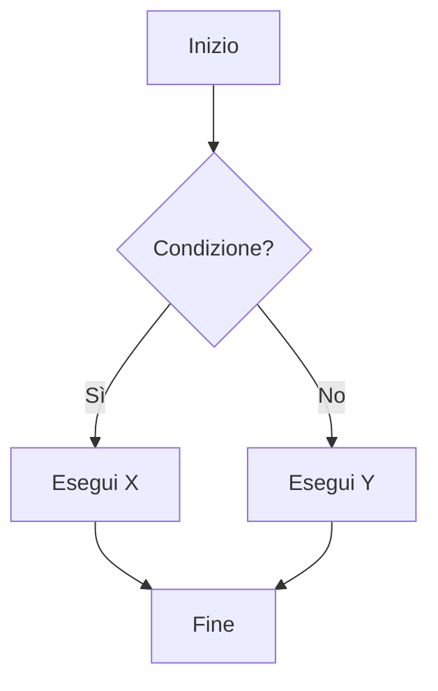
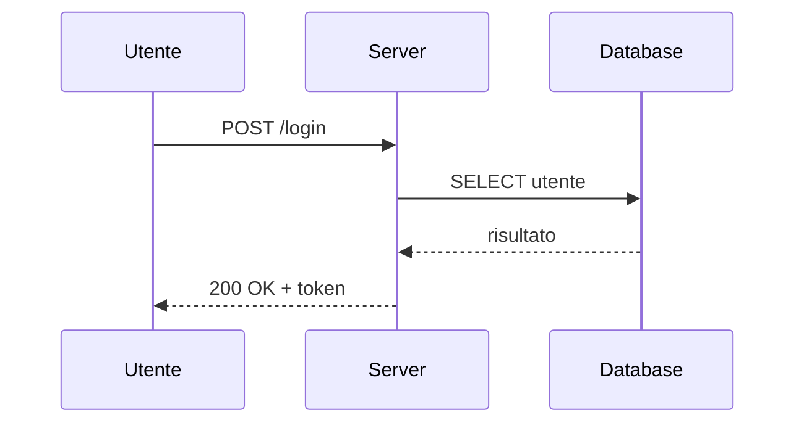
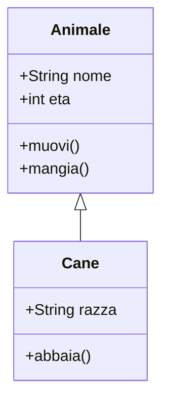
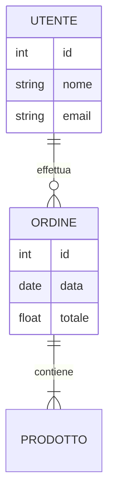
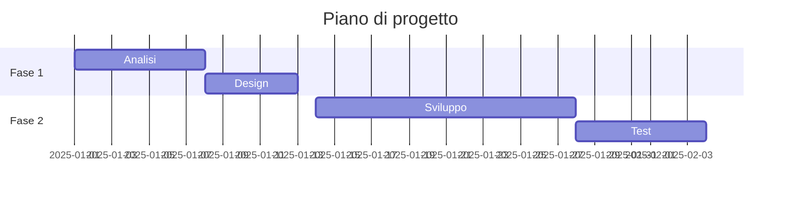
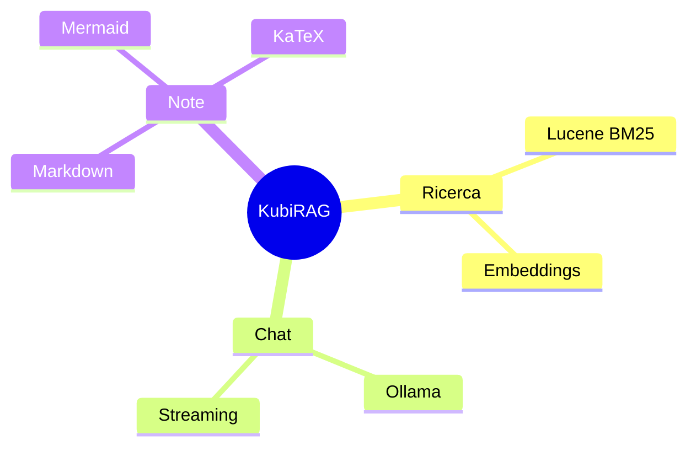
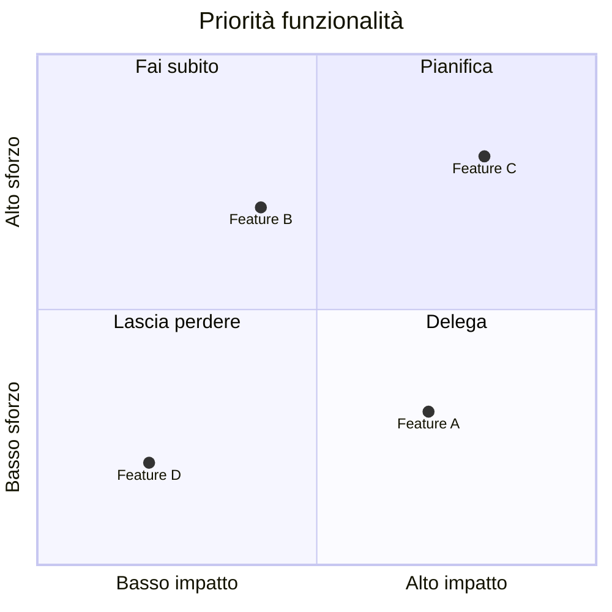
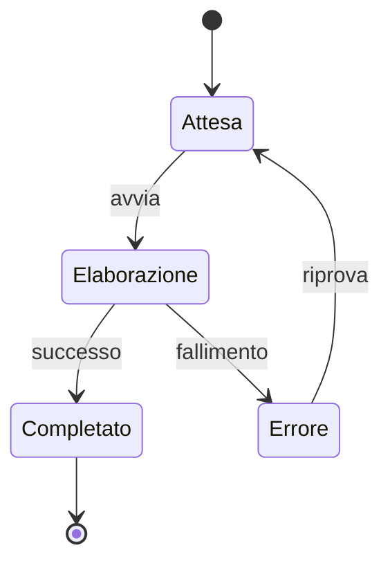
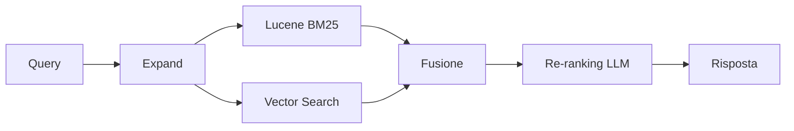

# Markboard — Manuale d'uso

Markboard è l'editor integrato di KubiRAG per la scrittura di note in Markdown.
Supporta rendering live di **Markdown**, **diagrammi Mermaid** e **formule LaTeX** via KaTeX.

---

## Accesso

| Azione | URL / Come |
|---|---|
| Aprire l'editor standalone | `http://localhost:7070/markboard` |
| Creare una nuova nota | Cliccare **Add note** in Ragboard, oppure andare a `/markboard?note=__new__` |
| Modificare una nota esistente | Cliccare ✎ accanto alla nota in Ragboard, oppure `/markboard?note=nome-nota` |

---

## Interfaccia

```
┌──────────────────────────────────────────────────────────────┐
│  📝 Markdown & Mermaid Editor   [💾 Save Note] [← Back]     │
├───────────────────────┬──────────────────────────────────────┤
│  Editor (sinistra)    │  Preview (destra)                    │
│                       │                                      │
│  ← scrivi qui         │  ← il risultato aggiorna in tempo   │
│                       │    reale mentre scrivi               │
└───────────────────────┴──────────────────────────────────────┘
```

- **💾 Save Note** — salva la nota corrente via API (`Ctrl+S` fa lo stesso in note-mode)
- **← Back** — torna a Ragboard (il browser avvisa se ci sono modifiche non salvate)
- **Choose Template** — inserisce un documento di esempio precompilato

---

## Markdown

### Titoli

```markdown
# H1 — Titolo principale
## H2 — Sezione
### H3 — Sottosezione
#### H4
```

### Testo

```markdown
**grassetto**   *corsivo*   ~~barrato~~   `codice inline`

> Citazione / blockquote

Paragrafo separato da una riga vuota.
```

### Liste

```markdown
- elemento
- elemento
  - annidato
  - annidato

1. primo
2. secondo
3. terzo
```

### Tabelle

```markdown
| Colonna A | Colonna B | Colonna C |
|-----------|:---------:|----------:|
| sinistra  |  centro   |   destra  |
| valore    |  valore   |   valore  |
```

### Codice a blocchi

````markdown
```python
def somma(a, b):
    return a + b
```

```json
{ "chiave": "valore", "numero": 42 }
```
````

### Link e immagini

```markdown
[testo del link](https://esempio.com)


```

### Linea orizzontale

```markdown
---
```

---

## Mermaid — Diagrammi

I blocchi Mermaid vengono renderizzati come SVG interattivi. Ogni diagramma mostra il
pulsante **🔍 Open** per aprirlo a schermo intero (con possibilità di esportare SVG o PNG).

Sintassi generale:

````markdown
```mermaid
<tipo-diagramma>
    <contenuto>
```
````

### Flowchart

````markdown

````

Direzioni disponibili: `TD` (top→down), `LR` (left→right), `BT`, `RL`.

Forme nodi:
- `[testo]` — rettangolo
- `(testo)` — stadio (angoli arrotondati)
- `{testo}` — rombo (decisione)
- `((testo))` — cerchio
- `>testo]` — asimmetrico

### Sequence Diagram

````markdown

````

Frecce:
- `->>` solida con punta
- `-->>` tratteggiata con punta
- `-x` solida con X (messaggio perso)

### Class Diagram

````markdown

````

### Entity Relationship (ER)

````markdown

````

### Gantt (pianificazione)

````markdown

````

### Mindmap

````markdown

````

### Quadrant Chart

````markdown

````

### State Diagram

````markdown

````

---

## KaTeX — Formule matematiche

KaTeX interpreta la sintassi LaTeX per la matematica.

### Inline (nella riga di testo)

Racchiudere la formula tra `$...$`:

```markdown
La formula di Eulero è $e^{i\pi} + 1 = 0$.

L'energia è $E = mc^2$ dove $c \approx 3 \times 10^8 \text{ m/s}$.
```

### Display (blocco centrato)

Racchiudere tra `$$...$$`:

```markdown
$$
\int_0^\infty e^{-x^2} dx = \frac{\sqrt{\pi}}{2}
$$
```

```markdown
$$
\sum_{n=1}^{\infty} \frac{1}{n^2} = \frac{\pi^2}{6}
$$
```

### Frazioni e potenze

```markdown
$$
f(x) = \frac{x^2 + 2x + 1}{(x+1)^2} = 1
$$
```

### Matrici e vettori

```markdown
$$
A = \begin{pmatrix}
a_{11} & a_{12} \\
a_{21} & a_{22}
\end{pmatrix}
$$
```

### Radici e limiti

```markdown
$$
\lim_{x \to 0} \frac{\sin x}{x} = 1
\qquad
\sqrt[3]{27} = 3
$$
```

### Simboli utili

| Simbolo | Codice KaTeX |
|---------|-------------|
| α β γ δ | `\alpha \beta \gamma \delta` |
| ∑ ∏ ∫ | `\sum \prod \int` |
| ∞ | `\infty` |
| ≤ ≥ ≠ ≈ | `\leq \geq \neq \approx` |
| → ← ↔ ⇒ | `\to \leftarrow \leftrightarrow \Rightarrow` |
| ∈ ∉ ⊂ ∪ ∩ | `\in \notin \subset \cup \cap` |
| × ÷ ± | `\times \div \pm` |

> **Nota:** il simbolo `$` usato come valuta deve essere escaped: `\$100`.

---

## KaTeX — Notazione per la Meccanica Quantistica

### Bra-ket (notazione di Dirac)

```markdown
Stato ket: $|\psi\rangle$   Stato bra: $\langle\psi|$

Prodotto interno: $\langle\phi|\psi\rangle$

Valore di aspettazione: $\langle\psi|\hat{H}|\psi\rangle$

Proiettore: $|\psi\rangle\langle\psi|$
```

### Equazione di Schrödinger

```markdown
$$
i\hbar \frac{\partial}{\partial t}|\psi(t)\rangle = \hat{H}|\psi(t)\rangle
$$
```

Forma stazionaria:

```markdown
$$
\hat{H}|\psi\rangle = E|\psi\rangle
$$
```

### Operatori e osservabili

```markdown
Operatore posizione: $\hat{x}$   Operatore momento: $\hat{p} = -i\hbar\nabla$

Commutatore: $[\hat{x}, \hat{p}] = i\hbar$

Operatori di scala (oscillatore armonico):
$$
\hat{a} = \sqrt{\frac{m\omega}{2\hbar}}\left(\hat{x} + \frac{i\hat{p}}{m\omega}\right)
\qquad
\hat{a}^\dagger = \sqrt{\frac{m\omega}{2\hbar}}\left(\hat{x} - \frac{i\hat{p}}{m\omega}\right)
$$
```

### Funzione d'onda e densità di probabilità

```markdown
$$
\psi(x) = \langle x|\psi\rangle
\qquad
P(x) = |\psi(x)|^2
$$

Normalizzazione:
$$
\int_{-\infty}^{\infty} |\psi(x)|^2 \, dx = 1
$$
```

### Principio di indeterminazione di Heisenberg

```markdown
$$
\Delta x \, \Delta p \geq \frac{\hbar}{2}
$$
```

### Sovrapposizione e qubit

```markdown
Stato generico di un qubit:
$$
|\psi\rangle = \alpha|0\rangle + \beta|1\rangle, \quad |\alpha|^2 + |\beta|^2 = 1
$$

Stato di Bell (entanglement massimale):
$$
|\Phi^+\rangle = \frac{1}{\sqrt{2}}\left(|00\rangle + |11\rangle\right)
$$
```

### Gate quantistici (matrici)

```markdown
Hadamard:
$$
H = \frac{1}{\sqrt{2}}\begin{pmatrix} 1 & 1 \\ 1 & -1 \end{pmatrix}
$$

Pauli:
$$
\sigma_x = \begin{pmatrix} 0 & 1 \\ 1 & 0 \end{pmatrix}
\quad
\sigma_y = \begin{pmatrix} 0 & -i \\ i & 0 \end{pmatrix}
\quad
\sigma_z = \begin{pmatrix} 1 & 0 \\ 0 & -1 \end{pmatrix}
$$
```

### Simboli quantistici comuni

| Simbolo | Significato | Codice KaTeX |
|---------|-------------|-------------|
| $\hbar$ | costante di Planck ridotta | `\hbar` |
| $|\psi\rangle$ | ket | `|\psi\rangle` |
| $\langle\psi|$ | bra | `\langle\psi|` |
| $\hat{H}$ | operatore (cappello) | `\hat{H}` |
| $\otimes$ | prodotto tensoriale | `\otimes` |
| $\dagger$ | aggiunto hermitiano | `\dagger` |
| $\nabla^2$ | laplaciano | `\nabla^2` |
| $\partial$ | derivata parziale | `\partial` |

---

## KaTeX — Notazione per il Machine Learning

### Funzioni di perdita (Loss)

```markdown
Mean Squared Error:
$$
\mathcal{L}_{\text{MSE}} = \frac{1}{n}\sum_{i=1}^{n}(y_i - \hat{y}_i)^2
$$

Cross-Entropy (classificazione binaria):
$$
\mathcal{L}_{\text{CE}} = -\frac{1}{n}\sum_{i=1}^{n}\left[y_i \log\hat{y}_i + (1-y_i)\log(1-\hat{y}_i)\right]
$$
```

### Regressione e predizione

```markdown
Regressione lineare: $\hat{y} = \mathbf{w}^\top \mathbf{x} + b$

Forma matriciale su dataset:
$$
\hat{\mathbf{y}} = X\mathbf{w} + b
$$

Soluzione analitica (OLS):
$$
\mathbf{w}^* = (X^\top X)^{-1} X^\top \mathbf{y}
$$
```

### Funzioni di attivazione

```markdown
Sigmoid: $\sigma(z) = \dfrac{1}{1+e^{-z}}$

ReLU: $\text{ReLU}(z) = \max(0, z)$

Softmax (vettore $\mathbf{z} \in \mathbb{R}^K$):
$$
\text{softmax}(\mathbf{z})_k = \frac{e^{z_k}}{\sum_{j=1}^{K} e^{z_j}}
$$
```

### Gradient Descent

```markdown
Aggiornamento parametri:
$$
\theta \leftarrow \theta - \eta \nabla_\theta \mathcal{L}(\theta)
$$

Con momentum:
$$
v_t = \beta v_{t-1} + (1-\beta)\nabla_\theta \mathcal{L}
\qquad
\theta \leftarrow \theta - \eta v_t
$$

Adam (update semplificato):
$$
\theta_{t+1} = \theta_t - \frac{\eta}{\sqrt{\hat{v}_t} + \epsilon}\hat{m}_t
$$
```

### Reti neurali e backpropagation

```markdown
Attivazione layer $l$:
$$
\mathbf{a}^{(l)} = f\!\left(W^{(l)}\mathbf{a}^{(l-1)} + \mathbf{b}^{(l)}\right)
$$

Regola delta (gradiente al layer $l$):
$$
\delta^{(l)} = \left(W^{(l+1)}\right)^\top \delta^{(l+1)} \odot f'\!\left(\mathbf{z}^{(l)}\right)
$$

dove $\odot$ è il prodotto elemento per elemento (Hadamard).
```

### Probabilità e Bayes

```markdown
Teorema di Bayes:
$$
P(\theta \mid \mathcal{D}) = \frac{P(\mathcal{D} \mid \theta)\, P(\theta)}{P(\mathcal{D})}
$$

Distribuzione Gaussiana:
$$
\mathcal{N}(x \mid \mu, \sigma^2) = \frac{1}{\sqrt{2\pi\sigma^2}} \exp\!\left(-\frac{(x-\mu)^2}{2\sigma^2}\right)
$$
```

### Attention (Transformer)

```markdown
Scaled Dot-Product Attention:
$$
\text{Attention}(Q, K, V) = \text{softmax}\!\left(\frac{QK^\top}{\sqrt{d_k}}\right)V
$$

Multi-Head Attention:
$$
\text{MHA}(Q,K,V) = \text{Concat}(\text{head}_1,\ldots,\text{head}_h)\,W^O
\quad \text{con} \quad \text{head}_i = \text{Attention}(QW_i^Q, KW_i^K, VW_i^V)
$$
```

### Metriche di valutazione

```markdown
Accuracy: $\text{Acc} = \dfrac{TP + TN}{TP + TN + FP + FN}$

Precision e Recall:
$$
P = \frac{TP}{TP+FP} \qquad R = \frac{TP}{TP+FN}
$$

F1 Score:
$$
F_1 = 2 \cdot \frac{P \cdot R}{P + R}
$$

AUC-ROC: area sotto la curva $\text{TPR}$ vs $\text{FPR}$.
```

### Regolarizzazione

```markdown
L2 (Ridge): $\mathcal{L}_{\text{reg}} = \mathcal{L} + \lambda\|\mathbf{w}\|_2^2$

L1 (Lasso): $\mathcal{L}_{\text{reg}} = \mathcal{L} + \lambda\|\mathbf{w}\|_1$

Dropout: con probabilità $p$, ogni neurone è azzerato durante il training.
```

### Simboli ML comuni

| Simbolo | Significato | Codice KaTeX |
|---------|-------------|-------------|
| $\mathbf{x}, \mathbf{w}$ | vettori (bold) | `\mathbf{x}`, `\mathbf{w}` |
| $X \in \mathbb{R}^{n \times d}$ | matrice dati | `X \in \mathbb{R}^{n \times d}` |
| $\mathcal{L}$ | funzione di loss | `\mathcal{L}` |
| $\nabla_\theta$ | gradiente rispetto a $\theta$ | `\nabla_\theta` |
| $\eta$ | learning rate | `\eta` |
| $\odot$ | prodotto Hadamard | `\odot` |
| $\hat{y}$ | predizione | `\hat{y}` |
| $\mathbb{E}[X]$ | valore atteso | `\mathbb{E}[X]` |
| $\mathcal{N}$ | distribuzione normale | `\mathcal{N}` |
| $\top$ | trasposta | `\top` |

---

## Scorciatoie da tastiera

| Scorciatoia | Azione |
|---|---|
| `Ctrl+S` | Salva la nota (in note-mode) / Esporta .md (standalone) |
| `Ctrl+O` | Importa file `.md` o `.txt` |

---

## Flusso di lavoro tipico

1. In **Ragboard**, cliccare **Add note** → si apre Markboard in modalità nuova nota
2. Inserire un nome nel banner in cima (es. `analisi-requisiti`)
3. Scrivere il contenuto usando Markdown, Mermaid e/o KaTeX
4. Cliccare **💾 Save Note** o premere `Ctrl+S`
5. Markboard reindirizza automaticamente alla modalità di modifica della nota appena creata
6. Cliccare **← Back** per tornare a Ragboard
7. La nota appare nella lista — cliccare il nome per visualizzarla nel viewer integrato,
   oppure ✎ per riaprirla in Markboard

---

## Esempi combinati

### Nota tecnica con formula e diagramma

````markdown
# Analisi prestazioni

La complessità dell'algoritmo di ricerca è $O(n \log n)$.

## Flusso di esecuzione



## Formula di fusione (RRF)

$$
\text{score}(d) = \sum_{r \in R} \frac{1}{k + r(d)}
$$

dove $k = 60$ e $r(d)$ è il rank del documento $d$ nella lista $r$.
````
